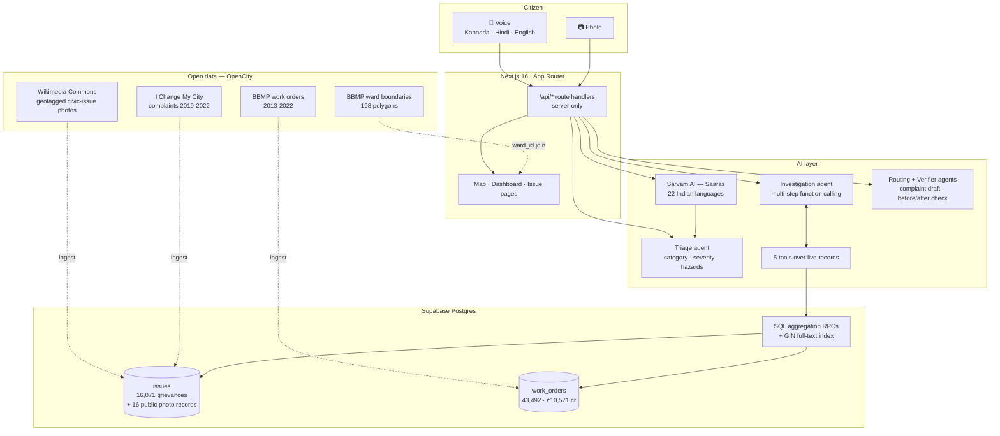

# CivicPulse — Transparent Civic Grievance & Infrastructure Triage

> A citizen reports a civic issue with a photo — or by **speaking in Kannada**. An AI agent
> pipeline triages it, routes it to the real responsible agency, and then does the thing no
> complaint box does: it checks what the city **already spent** in that ward, and says so.

Built for the **Forge Gen AI Buildathon**, Theme 1 — *Civic Pulse, Digital Governance & Public
Information*. Demo scope: **Bengaluru**.

**Live app: <https://civicpulse-forge.vercel.app>**

---

## How a report flows

1. **Report** — a photo, or speech in any of 22 Indian languages (Sarvam AI keeps the
   citizen's exact words). Location comes from the device; if it can't, the reporter is told.
2. **Triage agent** (Gemini, multimodal) — category, severity 1–5, hazards, confidence.
3. **Dedup agent** (deterministic) — clusters same-category reports within 250 m.
4. **Routing agent** — routes to the agency that actually handles that category, *counted*
   from the real records, and drafts the formal complaint.
5. **Investigation agent** — multi-step function calling over five tools and the live
   records, with its tool-call trace shown on the issue page (below).
6. **Community + Resolution Verifier agent** — neighbours confirm (3 confirmations verify a
   report); the verifier compares before/after photos to confirm a fix.
7. **Accountability dashboard + ward map** — agency and ward resolution rates over every
   record, computed in SQL.

---

## What makes this more than a complaint form

```
16,071  real grievances          2019-01-01 → 2022-07-31
43,492  real BBMP work orders    ₹10,571 crore recorded
   198  real BBMP ward boundaries
```

Every figure below came out of those records, not out of a seed script:

| | |
|---|---|
| **31.4%** | of decided grievances were resolved |
| **10,802** | still open |
| **332** | re-opened *after* being closed out |
| **KSPCB 3% · BESCOM 5% · BCP 5% · BWSSB 7% · BTP 30% · BBMP 36%** | resolution rate by agency |
| **4 of 197** | wards clear 60% resolution. 28 sit below 20%. |
| **Hemmigepura** | ₹183.7 crore of work orders. 108 of its 134 grievances still open. 19.4% resolved. |

That last line is the product. Complaints are easy to collect; setting them against **money
actually spent** is what an off-the-shelf chatbot cannot do.

---

## Architecture



**Everything aggregates in Postgres.** No endpoint ever pulls rows to count them — with 16k+
records that would silently report a number computed from whatever page happened to load.

---

## The investigation agent

Not a one-shot prompt. It plans, calls tools over the live records, recovers when a tool rejects
its arguments, and **renders its own tool-call trace in the UI** so the reasoning is inspectable
rather than asserted.

A real run on a Hemmigepura pothole:

```
1. search_similar_grievances  → 13 records within 1km · 4 resolved, 9 open
2. get_category_routing       → pothole → BBMP (5,370 records)
3. get_ward_stats             → Hemmigepura: 134 records, 19% resolved (rank 32/197)
4. get_agency_performance     → BBMP: 12,925 records, 36% resolved
5. search_ward_work_orders    → Ward 198: ₹183.71 crore across 422 orders
```

Its conclusion cited work orders **198-19-000003 (₹5.57 crore)** and **198-16-000022
(₹7.63 crore)** — both verified to exist, with matching amounts and real contractor names.

| Tool | Reads |
|---|---|
| `search_similar_grievances` | Nearby records, resolution rate, dominant ward |
| `get_ward_stats` | One ward's volume, rate and rank |
| `get_agency_performance` | An agency's resolved/open split |
| `get_category_routing` | Which agency handles a category — *counted*, not hardcoded |
| `search_ward_work_orders` | Ranked full-text retrieval over 43,492 work orders |

Tools never throw. A bad argument returns `{ error, hint, did_you_mean }` so the agent corrects
itself — and that recovery is visible in the trace.

---

## Voice reports, in your own language

The problem statement asks for *"visual **or** audio reports"*. A citizen can speak instead of
typing — and instead of having to use English at all.

Verified end to end with real Kannada speech:

```
heard       ಈ ರಸ್ತೆಯಲ್ಲಿ ದೊಡ್ಡ ಗುಂಡಿ ಇದೆ. ಬೈಕ್ ಸವಾರರು ಬೀಳುತ್ತಿದ್ದಾರೆ. ದಯವಿಟ್ಟು ಸರಿಪಡಿಸಿ.
detected    Kannada (kn-IN) — auto-detected
triaged     pothole · severity 4 · "Large pothole causing accidents"
hazards     ["risk to two-wheelers"]   ← which is what the audio actually says
```

The transcript is stored **verbatim in the language spoken** and shown on the issue page. The
English title and description are labelled as a summary written only from those words — the
prompt forbids adding a street, landmark, cause or measurement that was not said.

Sarvam AI handles the speech (22 Indian languages), which also keeps audio off the Gemini quota.

---

## No dummy data — and what that cost

> Hard rule: never seed, invent, mock or hardcode a record, count or placeholder number.

Honouring it properly meant refusing some convenient shortcuts:

- **`severity` and `photo_path` are NULL** on all 16,071 imported records. The source has no
  severity and no photo. Defaulting them would have invented data, so the UI renders no badge
  and a neutral map marker instead.
- **`rejected` (220) and `closed` (112) are real statuses**, excluded from every resolution rate
  rather than folded into "resolved" to make the number prettier.
- **Geolocation failure does not silently pin the city centre.** The reporter is told and must
  opt in; the choice is stored in `location_source` and surfaced as "approximate" wherever the
  pin appears.
- **A ward with no records is drawn unshaded**, never as 0%.
- **Imported records have no photos and never will.** There is no joinable image source — the
  dataset has no complaint id, I Change My City has no public API, and Swachhata publishes none.
  Attaching stock or scraped images would be fabrication. Before/after verification runs on
  citizen reports, which do have photos.
- **Photos come in as their own records instead.** 16 real, geotagged, freely licensed
  photos of Bengaluru civic problems from Wikimedia Commons (flooding in Tatanagar, sewage
  foam in the Bellandur storm drain, burning rubbish at Rampura Lake, …) are stored as
  standalone *public photo records*, each credited to its photographer with its licence,
  never attached to a grievance. Only the file list and each category were chosen by hand;
  location, date, photographer, licence and description come from the Commons API. They
  were never filed with an agency, so the agency and ward figures leave them out.

Every row carries `source`, `source_record_id`, `source_url`, `source_payload` and `ingested_at`.
Every imported issue page links to **"Verify this record at the source"**, which returns that
exact record from the government API.

---

## Data sources

| Dataset | Rows | Licence |
|---|---|---|
| [I Change My City Complaints Log 2019–2022](https://data.opencity.in/dataset/i-change-my-city-data) | 16,071 | CC-BY-SA · Janaagraha via OpenCity |
| [BBMP Work Orders by Ward 2013–2022](https://data.opencity.in/dataset/bbmp-work-orders-by-ward-2013-2022) | 43,492 | Public Domain |
| [BBMP Ward Information](https://data.opencity.in/dataset/bbmp-ward-information) | 198 polygons | OpenCity |
| [Wikimedia Commons](https://commons.wikimedia.org/) (curated in `scripts/ingest-commons.mjs`) | 16 photos | CC BY / CC BY-SA / CC0, credited per photo |

The three OpenCity datasets join on the **numeric BBMP ward id**, never on ward names — the datasets transliterate
the same places differently (Hoodi/Hudi, Ulsoor/Halsoor, Arekere/Arakere), and a name join
silently drops 22 of 198 wards.

---

## Stack

**Next.js 16** (App Router) · **React 19** · **TypeScript** · **Tailwind v4** · **Supabase**
(Postgres + private Storage + anonymous auth) · **Gemini** with a four-model fallback chain ·
**Sarvam AI** (Saaras) for speech · **Leaflet + OpenStreetMap** · deployed on **Vercel**.

No Google Maps key: Leaflet needs none, and Google Maps Platform requires a billing account,
which the hackathon's "free services only" rule forbids.

---

## Run it

Needs **Node.js 24** (the scripts import the app's TypeScript directly, which relies on
Node's built-in type stripping).

```bash
npm install
cp .env.example .env.local    # Gemini, Supabase and (for voice reports) Sarvam keys
npm run dev                   # http://localhost:3000
```

Then populate an empty database:

```bash
# 1. Run supabase/schema.sql in the Supabase SQL editor (idempotent; re-run it after pulling)
node --env-file=.env.local scripts/ingest-opencity.mjs      # 16,071 grievances
node --env-file=.env.local scripts/ingest-workorders.mjs    # 43,492 work orders
node --env-file=.env.local scripts/ingest-commons.mjs       # 16 public photo records
```

All three ingests are idempotent, retrying, and verify themselves against the database
afterwards. `--dry-run` shows what they would do without writing; the two OpenCity ingests
also take `--limit N` for a smoke test.

**[HANDOFF.md](HANDOFF.md)** has the full setup guide, every environment variable, and the ten
data traps found the hard way — including the two month-first date formats that silently corrupt
6,405 timestamps if you parse them day-first.

### Self-checks

```bash
node --import ./scripts/node-loader.mjs --env-file=.env.local scripts/test-tools.mjs
node --import ./scripts/node-loader.mjs --env-file=.env.local scripts/test-agent-recovery.mjs
```

12 assertions of the agent's tools against the live database, plus a check that the agent loop
recovers from a tool error and never cites a tool call that failed or never ran.

---

## Provenance

The Next.js/Supabase/UI shell is reused boilerplate from a prior civic project by the same
author. Built during the Forge window: the open-data ingestion and its grounding layer, the
multi-step agent loop and its tools, the work-order money trail with full-text retrieval, the
ward choropleth, voice reports, public photo records, and the accountability dashboard.
